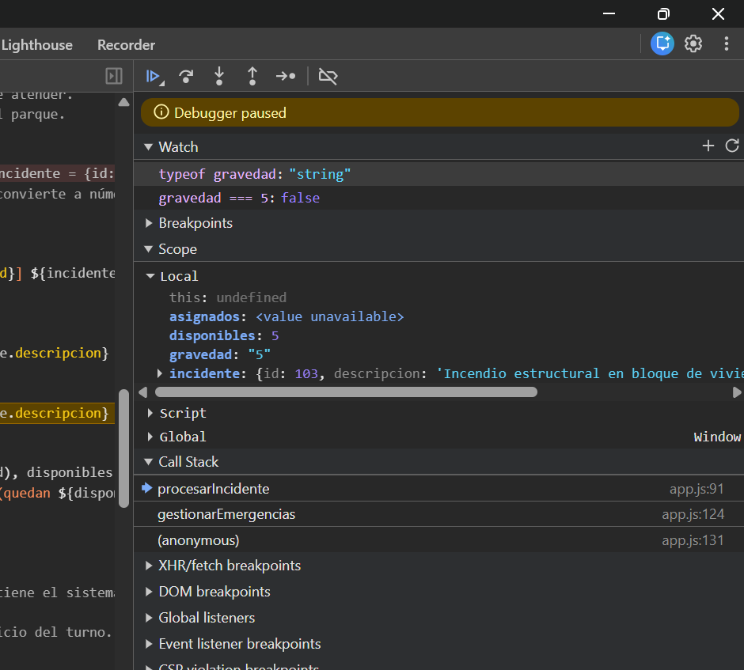
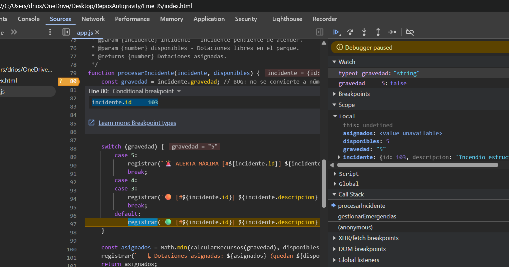
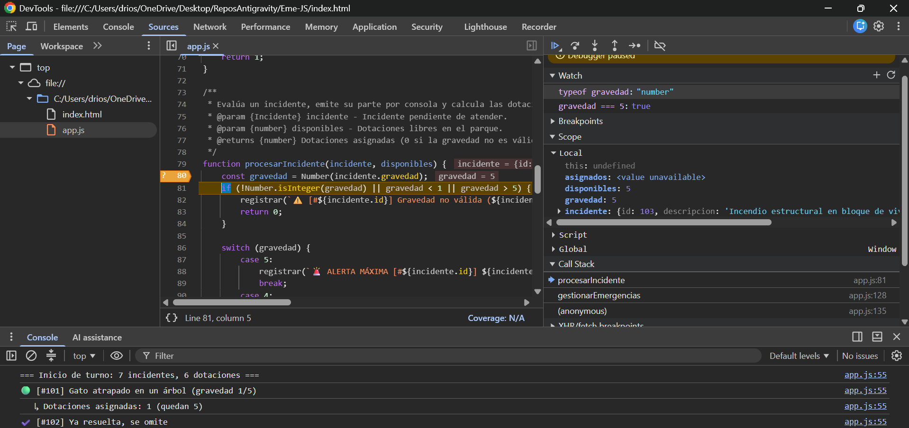
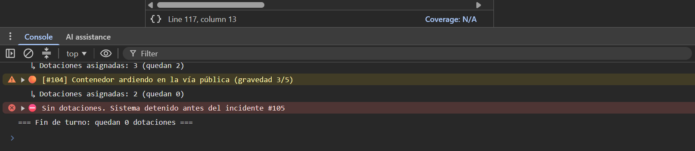

# 📔 Diario de Depuración y Co-Evaluación - Eme-JS

**Equipo:** DaniRZ10 — Daniel Ríos Zea (Driver inicial) & Pablobc1208 — Pablo Barrera Corbacho (Navigator inicial)

**Web en producción:** https://danirz10.github.io/Eme-JS/

### 🔍 Captura y Análisis de Variables (Debugger)

Detectamos que el incidente #103 (incendio, gravedad 5) no generaba alerta máxima. Colocamos `debugger;` en los dos puntos de filtrado del bucle (antes del `break` por falta de recursos y tras el filtro `continue` de incidentes resueltos) y un breakpoint condicional `incidente.id === 103` en `procesarIncidente`. Con la ejecución congelada, el Call Stack mostraba `procesarIncidente` ← `gestionarEmergencias` ← `(anonymous)`, y la ejecución había caído en el `default` del `switch`. En el Scope Local vimos `gravedad: "5"` entre comillas, y en Watch confirmamos `typeof gravedad → "string"` y `gravedad === 5 → false`: el `switch` compara de forma estricta y no entraba en `case 5`, mientras que `"5" >= 3` sí daba `true` por coerción implícita, asignando 2 dotaciones en vez de 3. Lo corregimos con una conversión explícita `Number(incidente.gravedad)` y validando el rango 1-5; tras el cambio, el Scope muestra `gravedad: 5` (number) y salta la alerta máxima.

### 👥 Experiencia de Pair Programming

Nos turnamos los roles en cada fase: Dani implementó el motor lógico y la corrección del bug, y Pablo la documentación JSDoc, su verificación con ESLint y el workflow de CI/CD, cambiando de Navigator a Driver en cada turno como refleja el historial de commits. Ser Navigator sin tocar el teclado nos obligó a explicar en voz alta cada decisión y a revisar el código con más calma. El Navigator detectó varios errores que el Driver pasó por alto: el incendio #103 sin alerta máxima por la gravedad recibida como texto, que los archivos de configuración de ESLint (`package.json`, `package-lock.json`, `eslint.config.mjs`) no se habían subido al repositorio, y que `.vscode/launch.json` tenía una ruta absoluta del ordenador de Pablo, que sustituimos por `${workspaceFolder}`.

*Firmado: Daniel Ríos Zea y Pablo Barrera Corbacho*